# 🧠 Mindflayer

**Your coding agents read skills and rules. Mindflayer keeps them in order.**

Claude Code, Codex and OpenCode each look for skills and rules in folders of
their own, project by project. Mindflayer keeps one library of them for all
your projects, puts each where the agents working in a project read it, tells
you which copies have fallen behind, and never touches anything it did not
write. Think of it as git for what your agents know.

<picture>
  <source media="(prefers-color-scheme: dark)" srcset="docs/images/project-dark.png">
  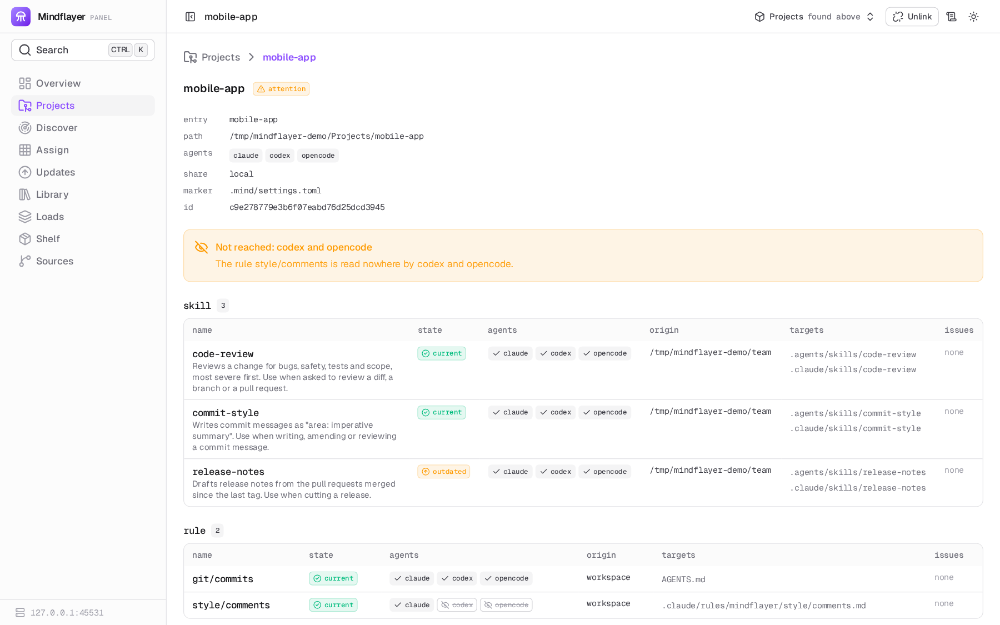
</picture>

It comes as two commands, `mind` for the project you are in and `flayer` for
the folder your projects sit in, with a TUI, and a control panel in your
browser, `flayer ui`, which this page tours.

## How it fits together

- A **project** is a repository with a small `.mind` folder, kept out of git
  unless your team shares it, naming the agents that work there.
- A **workspace** is the folder your projects sit in. Its `.mindflayer` links
  them, keeps a **library** of skills and rules of its own, and a **shelf**
  of skills gathered from git repositories.
- **Installing** copies a skill or a rule from either into a project, into
  each folder its agents read, and remembers what it wrote: that is what lets
  Mindflayer update it or take it out later, and leave everything else alone.

## Install

Mindflayer is young, and development targets **Linux** for now: macOS and
Windows are tested only on request. It installs from source, with a recent
stable Rust, and Node 24 with pnpm to build the panel:

```bash
git clone https://github.com/otsobide/mindflayer
cd mindflayer
make install
```

That puts `mind` and `flayer` in `~/.cargo/bin`, with the panel built into
them. Without Node, `cargo install --path apps/cli --locked` installs the
same commands and the TUI, and the panel then only says it was not built.

## Open the panel

```bash
cd ~/Projects      # the folder your repositories are in
flayer init        # make it a workspace
flayer ui          # serve the control panel and open it in your browser
```

The panel is served by the binary itself, on 127.0.0.1 only, through a link
carrying a token made for that launch, until you press Ctrl-C. It follows the
disk: a change made from a terminal, the TUI or an editor shows within a
moment, without a reload. It is dark until you pick light, as these pictures
do.

## A tour of the panel

### Overview

What the workspace holds at a glance: the projects it links, the skills and
rules in them and in its library, the installs that have fallen behind or
been changed by hand, what is on the shelf, and anything that could not be
read.

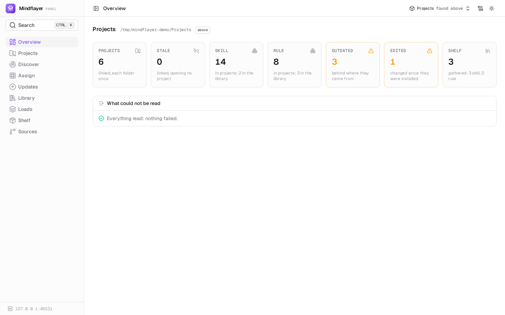

### Projects

Every project the workspace links, with its agents, whether it is shared or
kept local, what it holds, how much of it has fallen behind where it came
from, and one word for its health. Sort, filter, or link another by its
path.

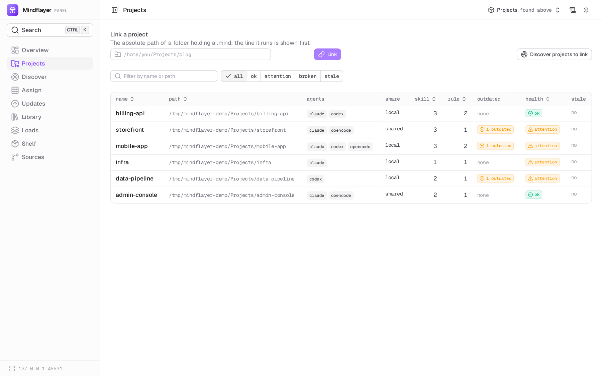

### A project

A project's page, at the top of this one, groups what it holds by kind. Each
skill and rule says how it stands (`current`, `outdated`, `edited`,
`authored`...), which of the project's agents read it, where it came from
and where its copies are, and the page warns of what some agent never reads.
Below, toggles change the project's agents and how it shares, and carry what
is installed to where the agents now read. A skill somebody keeps by hand in
an agent's folder, which reads as `foreign`, can be adopted into the library
from its row, after which Mindflayer manages it like anything it installed.

### The library

The workspace's own skills and rules, each with the projects holding a copy
and how every copy stands.

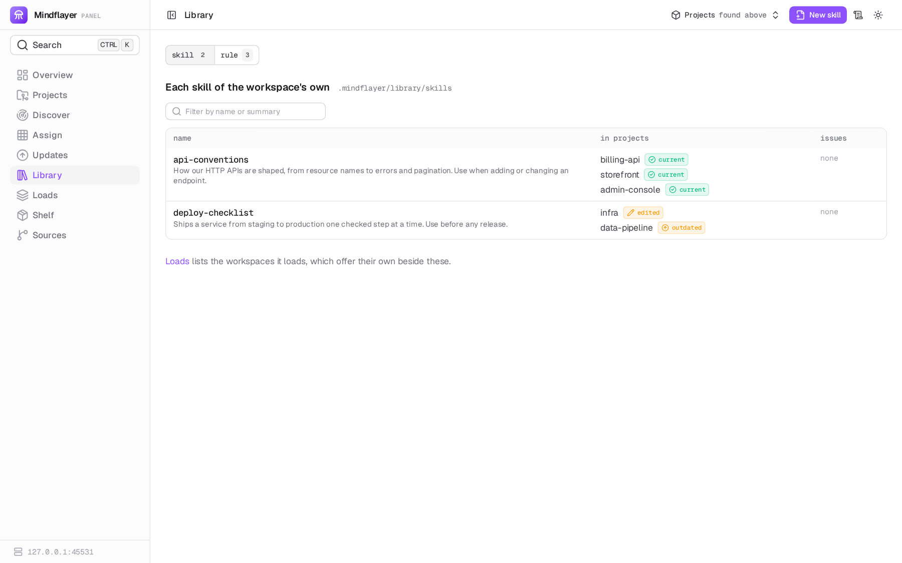

Each one opens on a page of its own: what its front matter declares, its
body rendered, every file it carries, what `validate` says of it and where
it is installed.

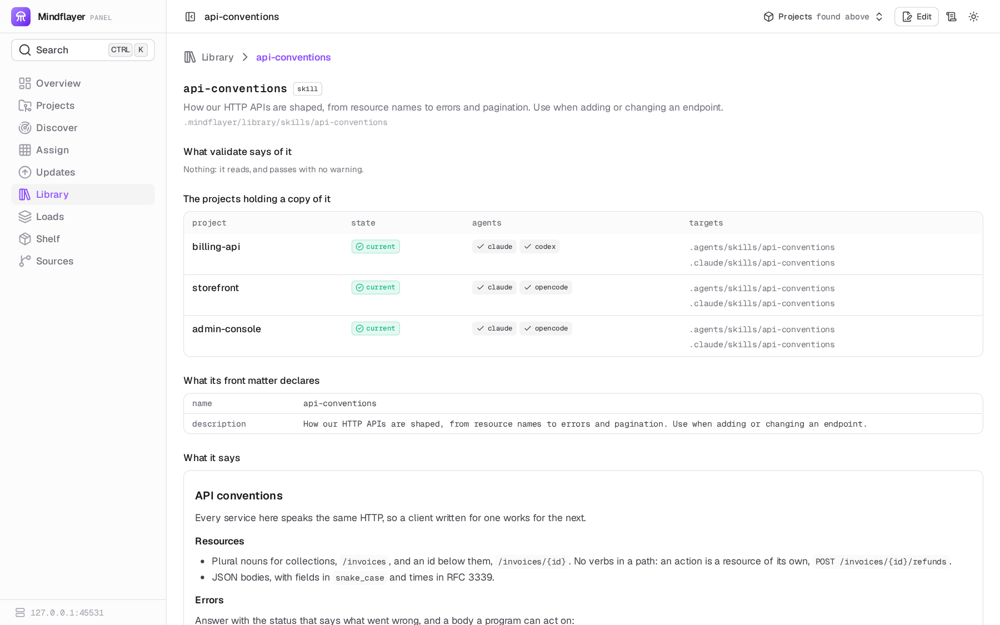

**Edit** opens its `SKILL.md`, or a rule's file, in an editor in the page.
As you type, core judges the text by the rules a save is held to and says
what `flayer validate` would say of it, in the same words. Saving runs
`flayer edit --contents` with the text, shown first like every change, and
only over what the file held when you opened it: a change made to it
meanwhile, from an editor or a terminal, is never written over, and the
save says so. A copy installed from it then reads as outdated, for Updates
to bring along.

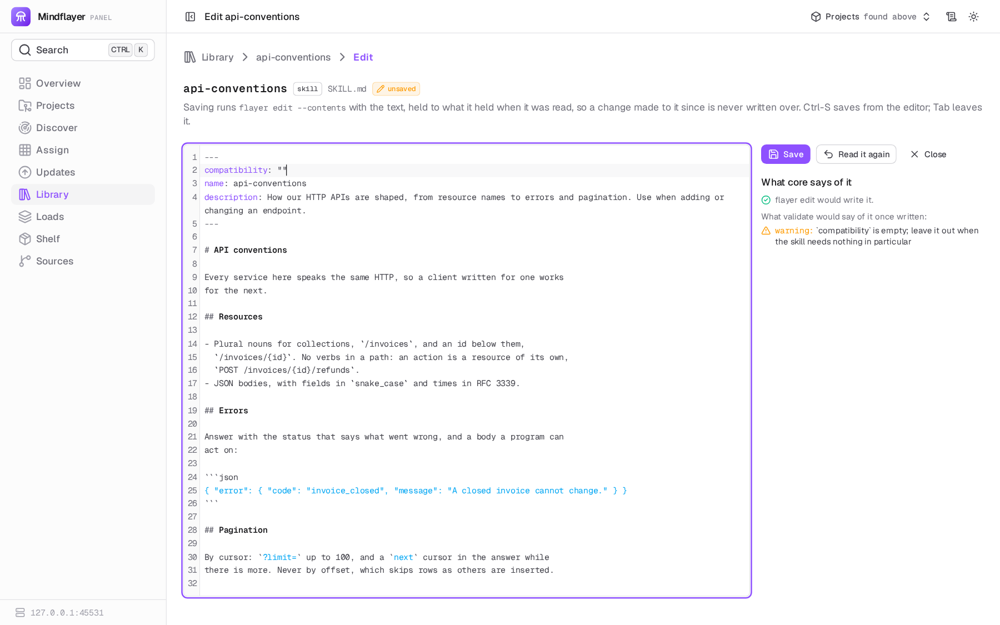

**New skill** and **New rule** add one, from nothing or from a template,
judged as you type by what `flayer add` would refuse, and the page of each
renames it.

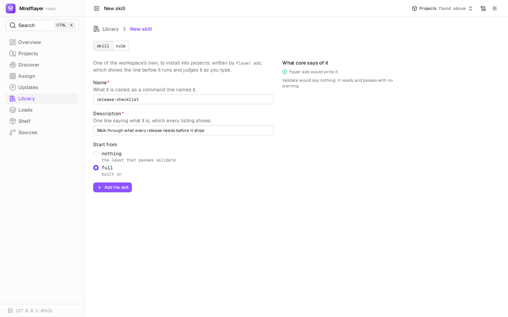

Removing one starts with what removing it everywhere would do: the copy
that goes from each project, and one changed by hand, which stays. Only
then is it removed, out of every project first and then the library, so no
copy installed as it was is left behind with nothing to update it from. A
copy changed by hand stays as it is, with nothing offering it any more,
until a forced uninstall from Updates takes it out.

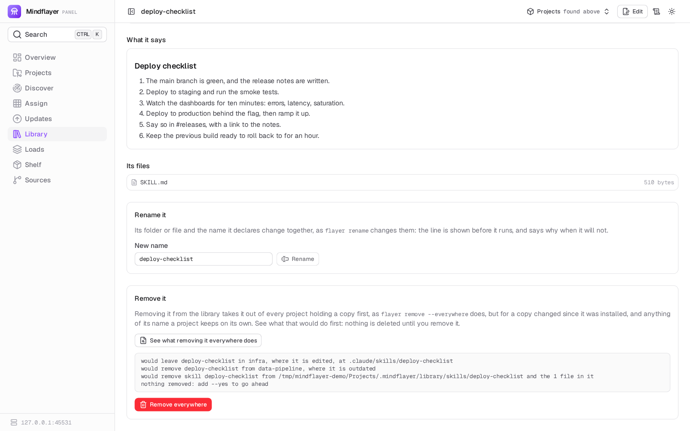

### Loaded workspaces

Another workspace's own skills and rules can be offered to your projects
beside the library's, read from where that workspace keeps them, so the
next install takes whatever it holds then. **Loads** lists each workspace
loaded, with what it offers and a link to assign those, and every workspace
this machine knows: the default one in your home remembers each that
`flayer init` makes. **Load** one of those, or name any other by its path;
**Unload** one, which asks first and leaves what was installed from it
where it is.

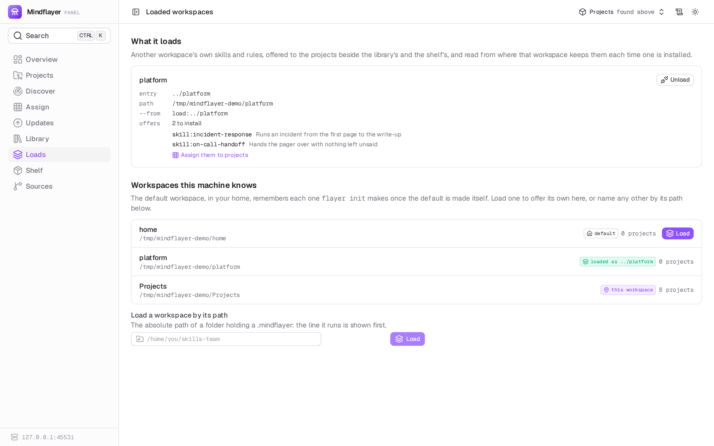

### Switching workspace

The header of every page names the workspace the panel works on and how it
was found. Press it to see every workspace this machine knows, and the one
you started the panel on, and switch to another without restarting: every
page then shows that one, and every command the panel runs names it with
`-W`, so the transcript says which workspace each line ran against.

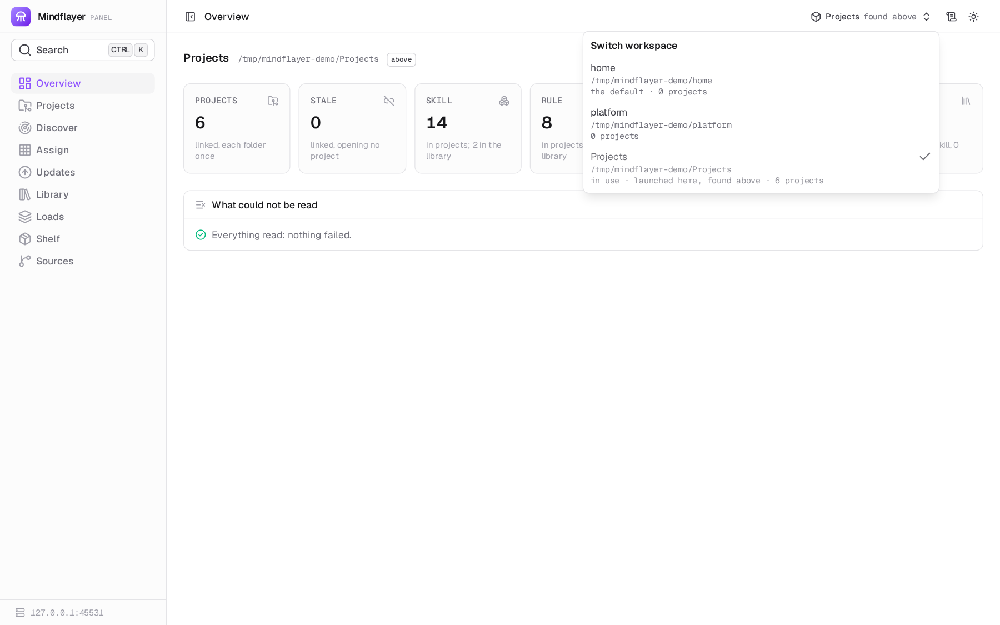

### The shelf and its sources

The shelf holds what was gathered from git repositories, each skill with
where it came from and the commit it was taken at. Sources lists those
repositories, and what happened lately: gathers, installs, relinks.

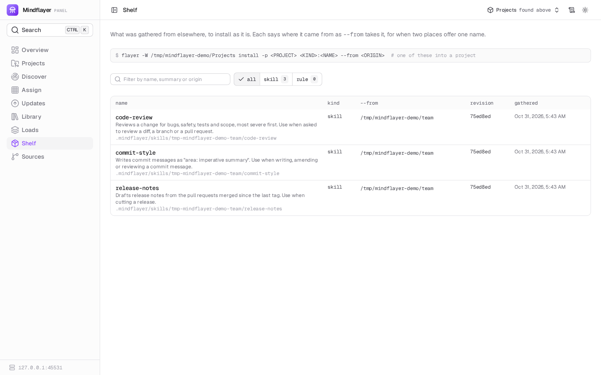

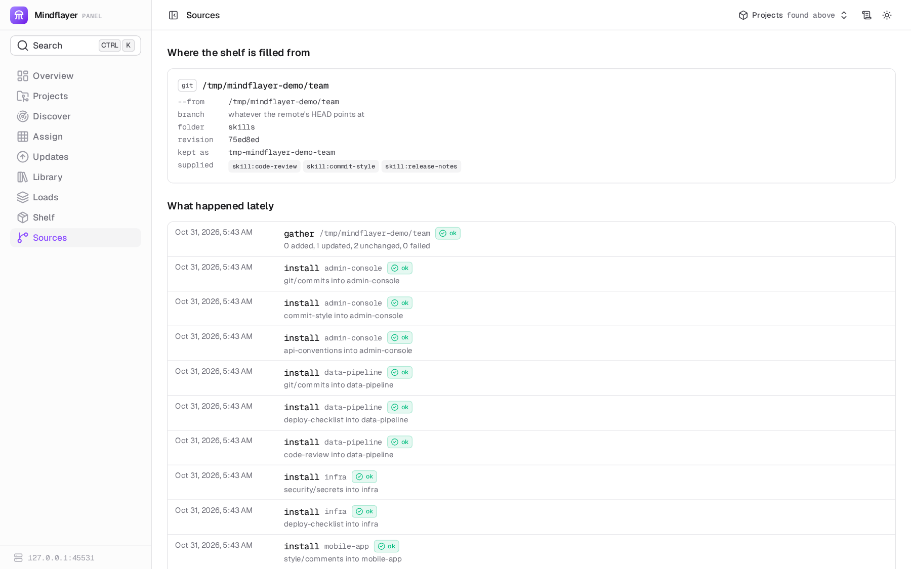

### Assign

Every skill and rule there is to install, from the library, the workspaces
it loads and the shelf, against every project. A box is ticked where the
project holds that one, and says how it stands there. Tick and untick
boxes, by offer or turned round by project, filtered by kind, origin, agent
or name, from the mouse or the arrow keys: below, the plan says what they
amount to, the `flayer install` and `flayer uninstall` lines it will run,
and what it holds back and why, such as a copy somebody wrote or changed by
hand, or one name asked of a project from two places. **Apply** runs the
lines, shown first.

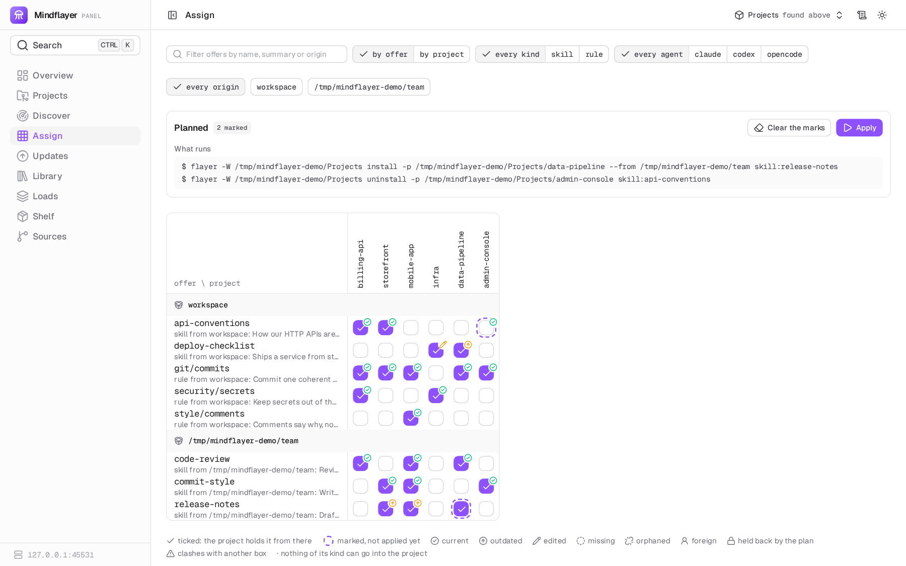

### Updates

What updating every project would do, before it does it: the copies behind
where they came from, those changed by hand, those gone missing and those
nothing offers any more, each with where it came from and what an update
does with it, or why it leaves it alone. **Update all**, one project, or
one skill or rule. A copy somebody changed is never written over unless you
force it, which asks first; what nothing offers any more is uninstalled,
one or all at once, and a copy of it changed by hand only by forcing its
uninstall, which asks first too.

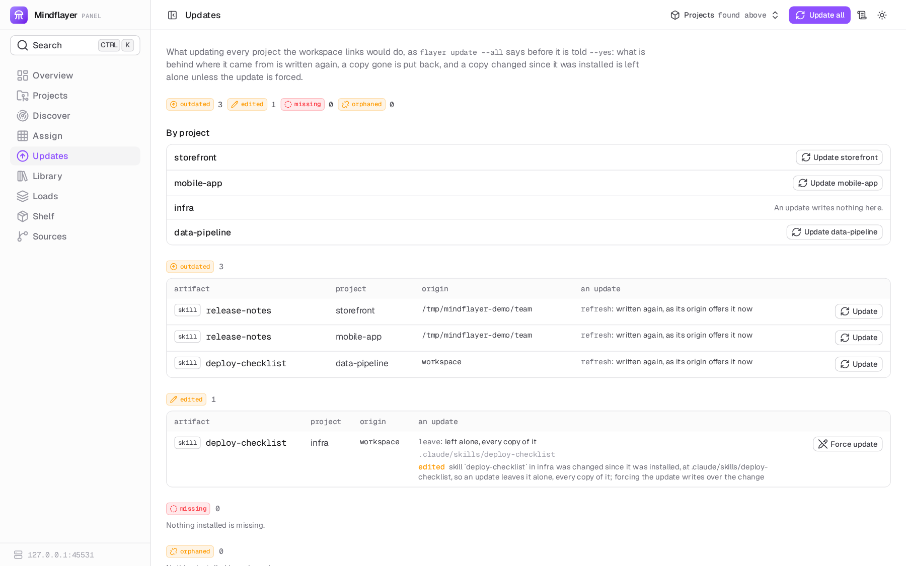

### Discover

Name the folders your repositories are kept in, and the panel finds what is
worth linking: mind projects first, then repositories an agent already works
in, then the rest. Tick them and link them in one go.

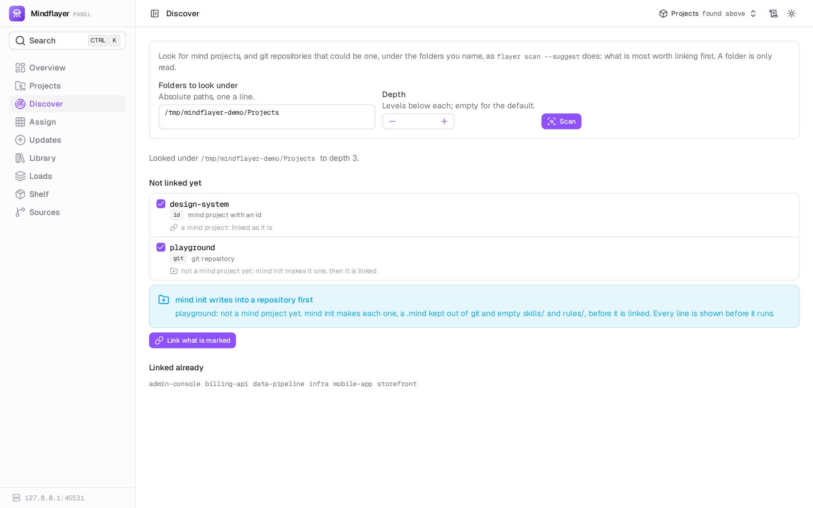

### The command palette and the keys

Press Ctrl+K, or Cmd+K on a Mac, on any page, or **Search** at the top of
the sidebar, and type: every page, project, skill and rule of the library,
what is on the shelf and where it came from, found by a few letters, a
typo forgiven, each word narrowing the rest. It acts too: **Install** a
skill or rule, then choose a project that could take it, as ticking its box
in Assign would; **Update all**; or **Link** the folder whose path you
typed. Each shows its lines before it runs, like every change below.

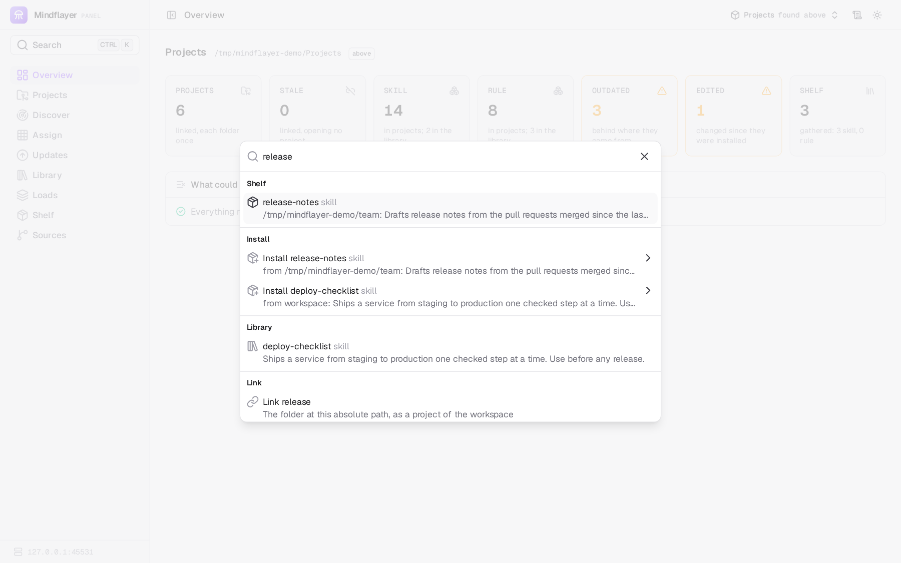

`?` lists every key the panel answers, and none of them is taken while you
type in a field or the editor:

| Keys | Where | What they do |
|---|---|---|
| Ctrl+K, or Cmd+K on a Mac | anywhere | open or close the command palette |
| `?` | anywhere | show or hide the keyboard shortcuts |
| ↑ ↓, Enter, Backspace, Esc | the palette | move, choose, go back from the projects to install into, close |
| Tab, Enter, Esc | a change asked about | move between Cancel and Run, press the one focused, cancel |
| arrows, Page Up and Down, Home and End, Ctrl with Home and End, Space | Assign's matrix | move a box or ten rows, to the end of a row or of the matrix, mark a box |
| Ctrl+S, or Cmd+S on a Mac, and Tab | the editor | save, shown first, and leave the editor |

### Every change is a command

The panel changes nothing behind your back. Whatever you ask for, it first
shows the command lines it will run, exactly as you could type them in the
workspace's folder, each naming the workspace with `-W`, and runs nothing
until you press Run.

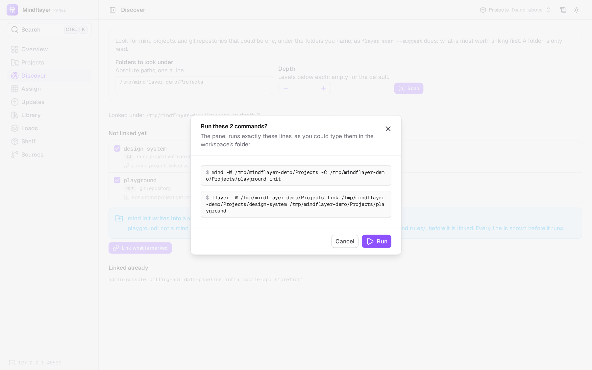

A line that takes something away is a question, saying in the command's own
words what it takes, with Cancel ready for an Enter pressed out of habit.

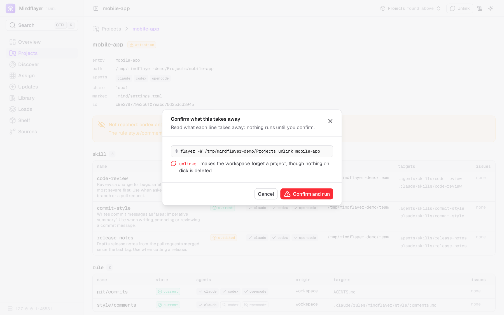

The transcript keeps every line the session ran, with what each said, and
**Copy as script** copies them, to run again in a shell.

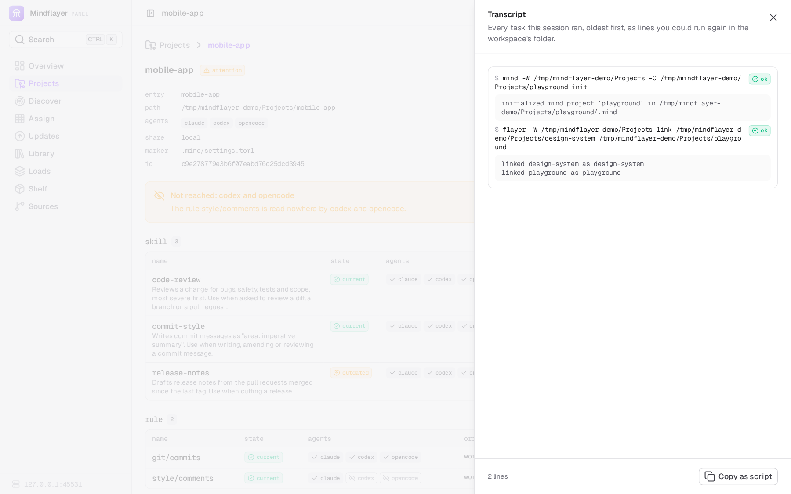

These pictures are taken by `make docs/screenshots` from a demo workspace,
so they show the panel as it is.

## From the terminal

Everything the panel does is a command, and so is everything it does not do
yet, such as gathering:

```bash
cd ~/Projects/blog && mind init      # make a repository a project
cd ~/Projects && flayer link blog    # and link it to the workspace
flayer gather git https://github.com/acme/skills   # put a repository's skills on the shelf
flayer install -p blog commit-style  # install one into a project
flayer status                        # what every project holds, and how it stands
flayer update --all --yes            # bring every project up to date
flayer                               # the TUI: all of it from the keyboard
```

To try it with nothing gathered, this repository's `examples/` is a
workspace of two skills and two rules: `flayer load <your clone>/examples`
offers them to yours.

[The reference](docs/reference.md) has every command with what it prints,
the formats Mindflayer reads and writes, `--json`, the TUI, and upgrading
from an older Mindflayer.

## Learn more

- [The reference](docs/reference.md): every command, with what it prints.
- [Developing Mindflayer](docs/development.md): building it, testing it, and
  working on the panel.
- [Architecture](docs/architecture.md): why each part is the way it is, and
  the decisions behind it.
- [Agents](docs/agents.md): where each agent reads skills and rules, as
  checked on each one.

## Roadmap

What comes next is planned as
[milestones](https://github.com/otsobide/mindflayer/milestones), each ending
with something usable on real repositories, and each issue in them is one pull
request. [#15](https://github.com/otsobide/mindflayer/issues/15) tracks the
whole plan, and the decisions it rests on are recorded in
[docs/architecture.md](docs/architecture.md#decisions).

## License

GPL-3.0-only. See [LICENSE](LICENSE).
