# 🧠 Mindweaver

**Your coding agents read skills and rules. Mindweaver keeps them in order.**

Claude Code, Codex and OpenCode each look for skills and rules in folders of
their own, project by project. Mindweaver keeps one library of them for all
your projects, puts each where the agents working in a project read it, tells
you which copies have fallen behind, and never touches anything it did not
write. Think of it as git for what your agents know.

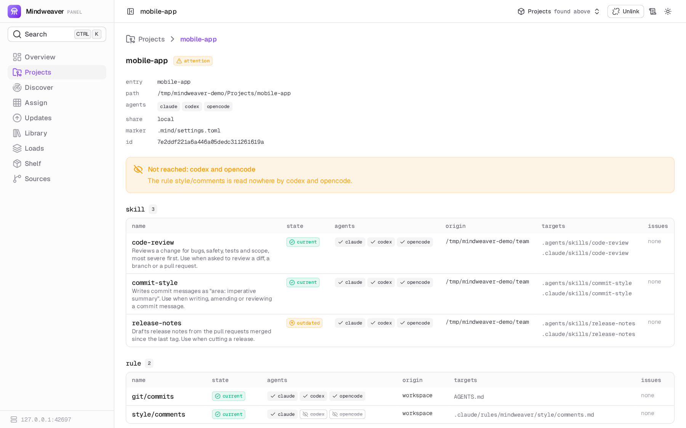

It comes as two commands, `mind` for the project you are in and `mindweaver` for
the folder your projects sit in, with a TUI, and a control panel in your
browser, `mindweaver ui`, which this page tours.

## How it fits together

- A **project** is a repository with a small `.mind` folder, kept out of git
  unless your team shares it, naming the agents that work there.
- A **workspace** is the folder your projects sit in. Its `.mindweaver` links
  them, keeps a **library** of skills and rules of its own, and the
  definitions of the MCP servers its projects use, and a **shelf** of skills
  gathered from git repositories.
- **Installing** copies a skill or a rule from either into a project, into
  each folder its agents read, and remembers what it wrote: that is what lets
  Mindweaver update it or take it out later, and leave everything else alone.

## Install

Mindweaver is young, and development targets **Linux** for now: macOS and
Windows are tested only on request. It installs from source, with a recent
stable Rust, and Node 24 with pnpm to build the panel:

```bash
git clone https://github.com/otsobide/mindweaver
cd mindweaver
make install
```

That puts `mind` and `mindweaver` in `~/.cargo/bin`, with the panel built into
them. Without Node, `cargo install --path apps/cli --locked` installs the
same commands and the TUI, and the panel then only says it was not built.

## Open the panel

```bash
cd ~/Projects      # the folder your repositories are in
mindweaver init    # make it a workspace
mindweaver ui      # serve the control panel and open it in your browser
```

The panel is served by the binary itself, on 127.0.0.1 only, through a link
carrying a token made for that launch, until you press Ctrl-C. It follows the
disk: a change made from a terminal, the TUI or an editor shows within a
moment, without a reload. It is dark until you pick light, as these pictures
do.

## A tour of the panel

### Overview

What the workspace holds at a glance: the projects it links, the skills,
rules and MCP servers in them and in its library, the installs that have
fallen behind or been changed by hand, what is on the shelf, and anything
that could not be read.

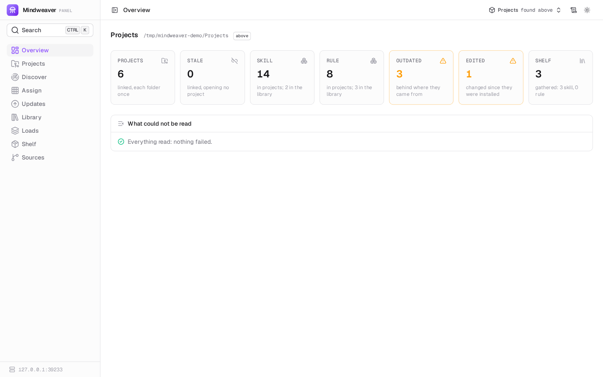

### Projects

Every project the workspace links, with its agents, whether it is shared or
kept local, what it holds, how much of it has fallen behind where it came
from, and one word for its health. Sort, filter, or link another by its
path.

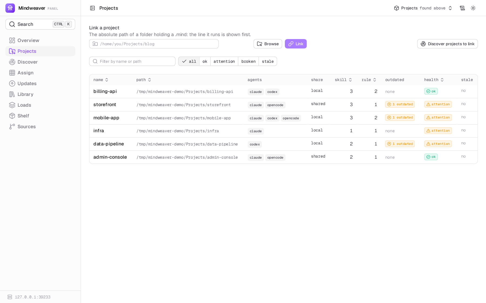

No need to remember the path: **Browse** opens an explorer of your folders,
starting at the workspace's own, and says what each one is (a mind
project, a workspace, a git repository or a plain folder) and which the
workspace links already. Walk down by a folder's name and back up by the trail, or
type a path to go there. Choosing one only fills the field: the link is
shown before it runs, like every change.

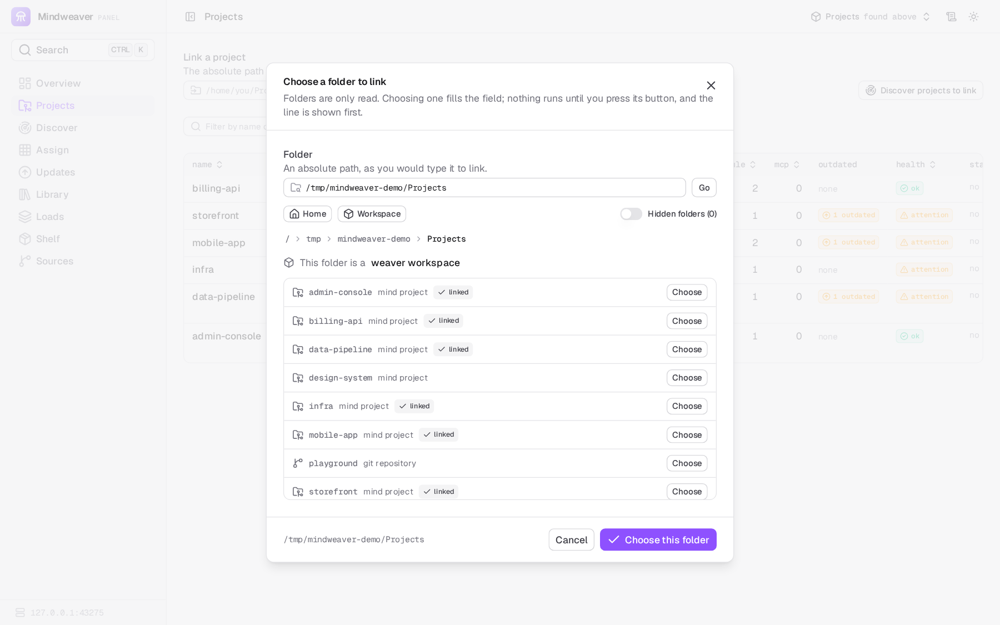

### A project

A project's page, at the top of this one, groups what it holds by kind. Each
skill and rule says how it stands (`current`, `outdated`, `edited`,
`authored`...), which of the project's agents read it, where it came from
and where its copies are, and the page warns of what some agent never reads.
Below, toggles change the project's agents and how it shares, and carry what
is installed to where the agents now read. A skill somebody keeps by hand in
an agent's folder, which reads as `foreign`, can be adopted into the library
from its row, after which Mindweaver manages it like anything it installed.

### The library

The workspace's own skills, rules and MCP servers, each with the projects
holding a copy and how every copy stands. An MCP server is a definition
`mindweaver add mcp` writes into the library ([MCP servers](#mcp-servers)),
installed into a project as an entry in each of its agents' own config
files.

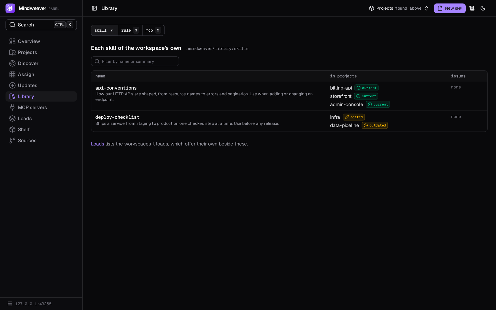

Each one opens on a page of its own: what its front matter declares, its
body rendered, every file it carries, what `validate` says of it and where
it is installed.

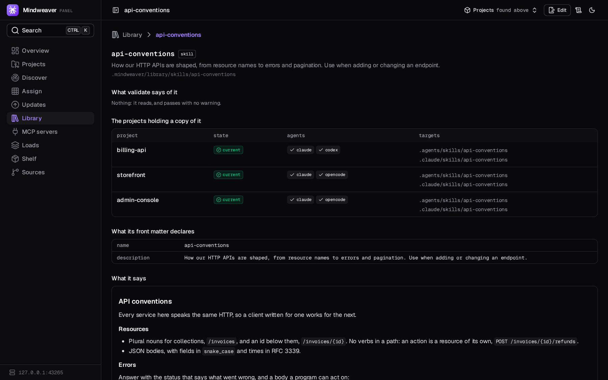

**Edit** opens its `SKILL.md`, or a rule's file, in an editor in the page.
As you type, core judges the text by the rules a save is held to and says
what `mindweaver validate` would say of it, in the same words. Saving runs
`mindweaver edit --contents` with the text, shown first like every change, and
only over what the file held when you opened it: a change made to it
meanwhile, from an editor or a terminal, is never written over, and the
save says so. A copy installed from it then reads as outdated, for Updates
to bring along.

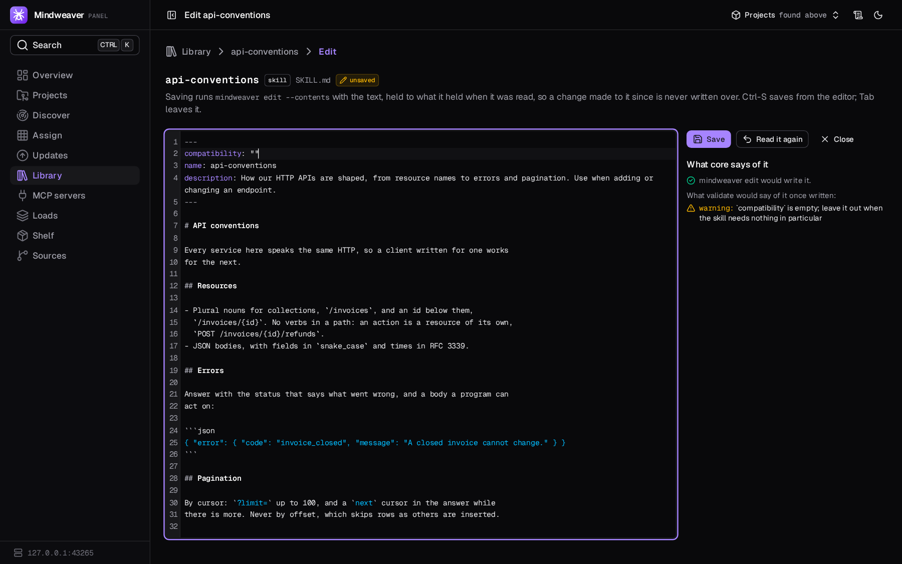

**New skill** and **New rule** add one, from nothing or from a template,
judged as you type by what `mindweaver add` would refuse, and the page of each
renames it.

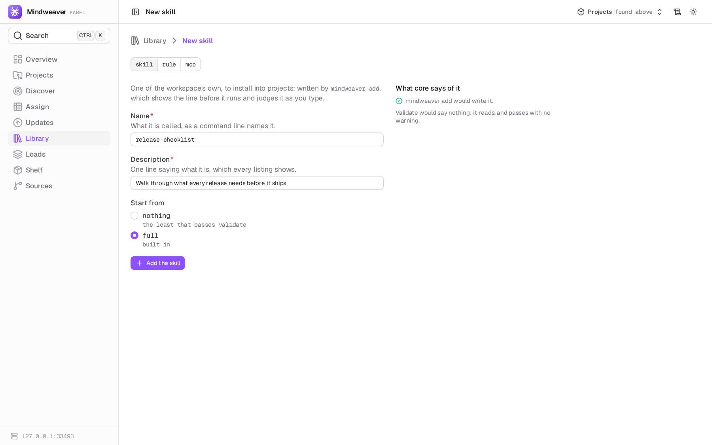

Removing one starts with what removing it everywhere would do: the copy
that goes from each project, and one changed by hand, which stays. Only
then is it removed, out of every project first and then the library, so no
copy installed as it was is left behind with nothing to update it from. A
copy changed by hand stays as it is, with nothing offering it any more,
until a forced uninstall from Updates takes it out.

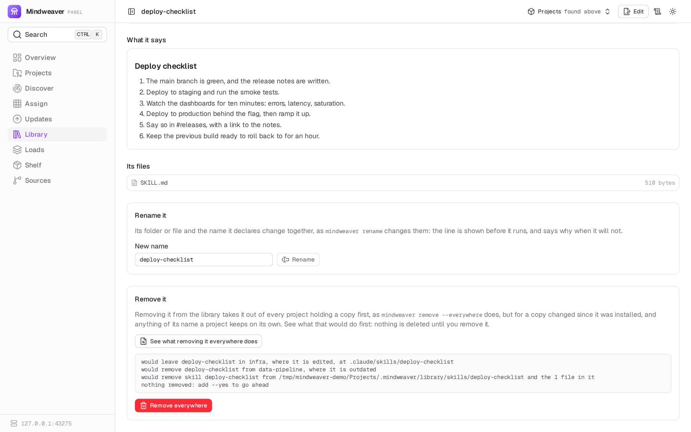

### The MCP page

The library's MCP servers have a page of their own. For each agent a
project names, it says whether the agent can be given a server, the command
it would run or the address it would reach, spelled as its own config file
would spell it, and what it asks before it starts one; for each project
holding a server, what `mindweaver doctor` finds there, such as a Codex
project nothing trusts or a variable that is not set where the agents run.

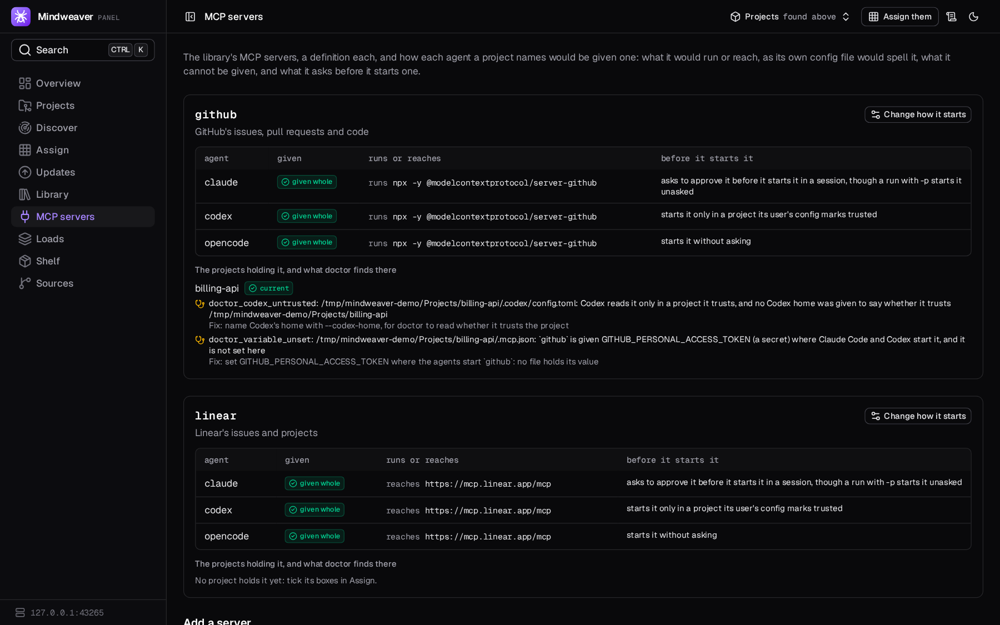

Its form adds a server, or changes how one is started or reached: a
program, its arguments and settings, or an address and its headers. A
secret is only ever the name of the environment variable an agent reads it
from, which is all Mindweaver stores: no field in a secret's place takes
its value. A setting or a header is written into the library as you type
it, as `--env` and `--header` write one, so no secret goes there. Core
judges what you type as `mindweaver add mcp` or `mindweaver edit`
would, and the line is shown before it runs.

### Loaded workspaces

Another workspace's own skills and rules can be offered to your projects
beside the library's, read from where that workspace keeps them, so the
next install takes whatever it holds then. **Loads** lists each workspace
loaded, with what it offers and a link to assign those, and every workspace
this machine knows: the default one in your home remembers each that
`mindweaver init` makes. **Load** one of those, or name any other by its path;
**Unload** one, which asks first and leaves what was installed from it
where it is.

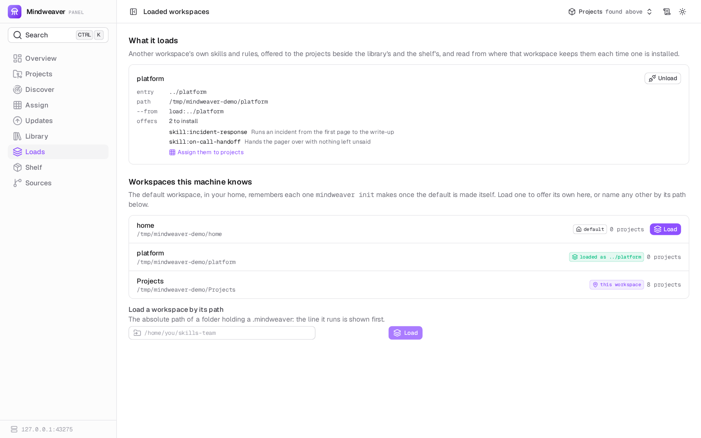

### Switching workspace

The header of every page names the workspace the panel works on and how it
was found. Press it to see every workspace this machine knows, and the one
you started the panel on, and switch to another without restarting: every
page then shows that one, and every command the panel runs names it with
`-W`, so the transcript says which workspace each line ran against.

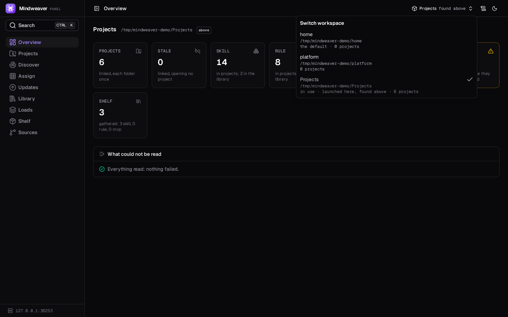

### The shelf and its sources

The shelf holds what was gathered from git repositories, each skill with
where it came from and the commit it was taken at. Sources lists those
repositories, and what happened lately: gathers, installs, relinks.

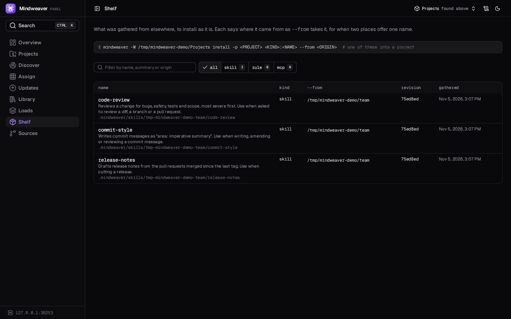

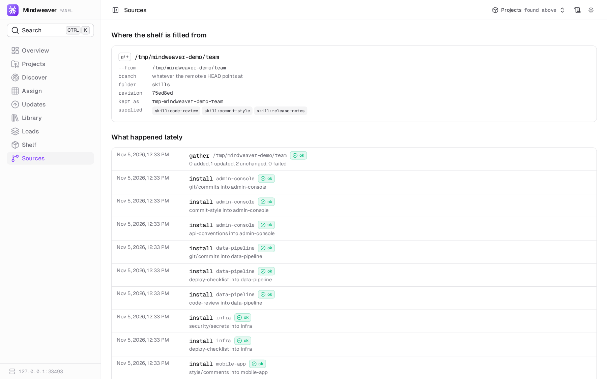

### Assign

Every skill, rule and MCP server there is to install, from the library,
the workspaces it loads and the shelf, against every project. A box is ticked where the
project holds that one, and says how it stands there. Tick and untick
boxes, by offer or turned round by project, filtered by kind, origin, agent
or name, from the mouse or the arrow keys: below, the plan says what they
amount to, the `mindweaver install` and `mindweaver uninstall` lines it will run,
and what it holds back and why, such as a copy somebody wrote or changed by
hand, or one name asked of a project from two places. **Apply** runs the
lines, shown first. An MCP server from a loaded workspace or the shelf is
somebody else's command for every agent to run: the plan shows what each
would run, and its line installs it only once you tick that you read them.

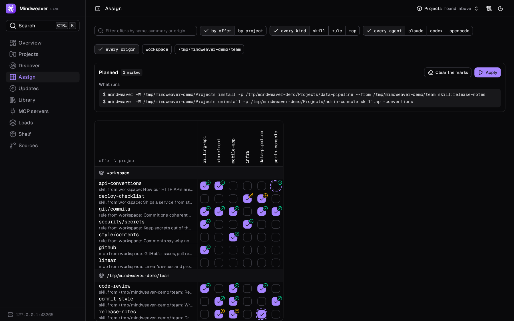

### Updates

What updating every project would do, before it does it: the copies behind
where they came from, those changed by hand, those gone missing and those
nothing offers any more, each with where it came from and what an update
does with it, or why it leaves it alone. **Update all**, one project, or
one skill or rule. A copy somebody changed is never written over unless you
force it, which asks first; what nothing offers any more is uninstalled,
one or all at once, and a copy of it changed by hand only by forcing its
uninstall, which asks first too.

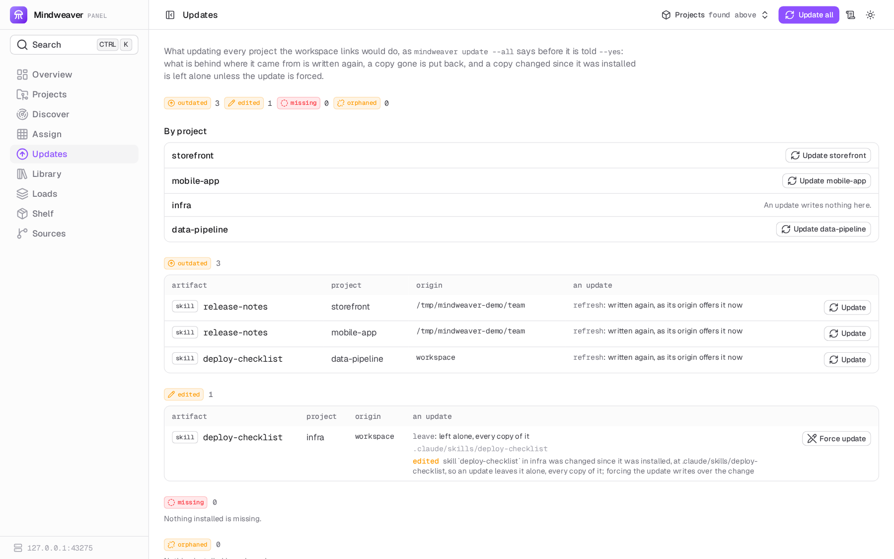

### Discover

Name the folders your repositories are kept in, typed or added with
**Browse** from the same explorer, and the panel finds what is worth
linking: mind projects first, then repositories an agent already works in,
then the rest. Tick them and link them in one go.

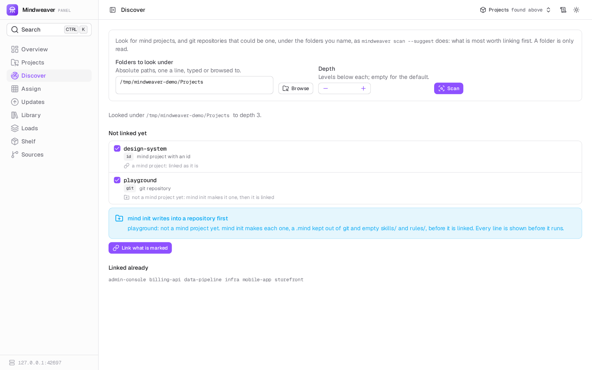

### The command palette and the keys

Press Ctrl+K, or Cmd+K on a Mac, on any page, or **Search** at the top of
the sidebar, and type: every page and project, the library's skills and
rules, what is on the shelf and where it came from, found by a few letters,
a typo forgiven, each word narrowing the rest. It acts too: **Install** a
skill or rule, then choose a project that could take it, as ticking its box
in Assign would; **Update all**; or **Link** the folder whose path you
typed. Each shows its lines before it runs, like every change below.

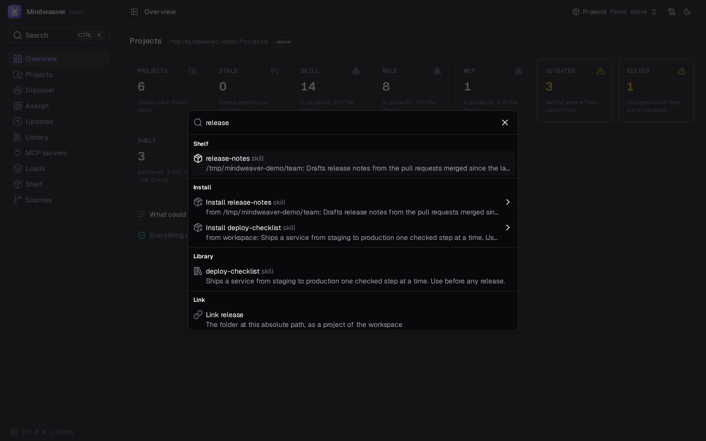

`?` lists every key the panel answers. Neither Ctrl+K nor `?` is taken
while you type in a field or the editor, whose keys they stay, but for the
palette's own search, which Ctrl+K closes:

| Keys | Where | What they do |
|---|---|---|
| Ctrl+K, or Cmd+K on a Mac | anywhere | open or close the command palette |
| `?` | anywhere | show or hide the keyboard shortcuts |
| ↑ ↓, Enter, Backspace, Esc or Ctrl+K | the palette | move, choose, go back from the projects to install into, close |
| Tab, Enter, Esc | a change asked about | move between Cancel and Run, press the one focused, cancel |
| arrows, Page Up and Down, Home and End, Ctrl with Home and End, Space | Assign's matrix | move a box or ten rows, to the end of a row or of the matrix, mark a box |
| Ctrl+S, or Cmd+S on a Mac, and Tab | the editor | save, shown first, and leave the editor |

### Every change is a command

The panel changes nothing behind your back. Whatever you ask for, it first
shows the command lines it will run, exactly as you could type them in the
workspace's folder, each naming the workspace with `-W`, and runs nothing
until you press Run.

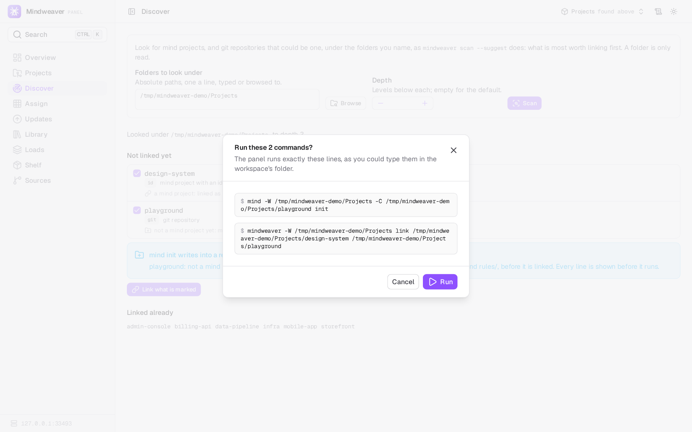

A line that takes something away is a question, saying in the command's own
words what it takes, with Cancel ready for an Enter pressed out of habit.

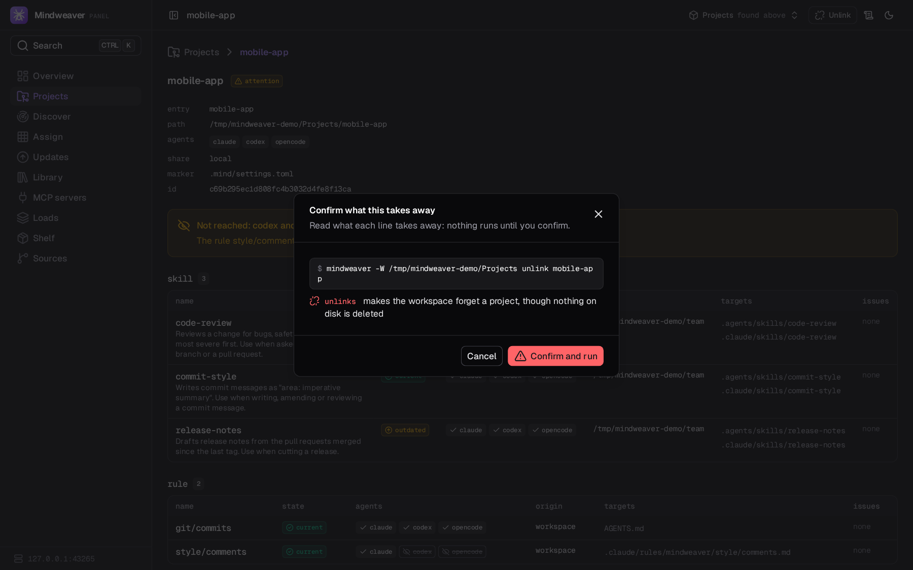

The transcript keeps every line the session ran, with what each said, and
**Copy as script** copies them, to run again in a shell.

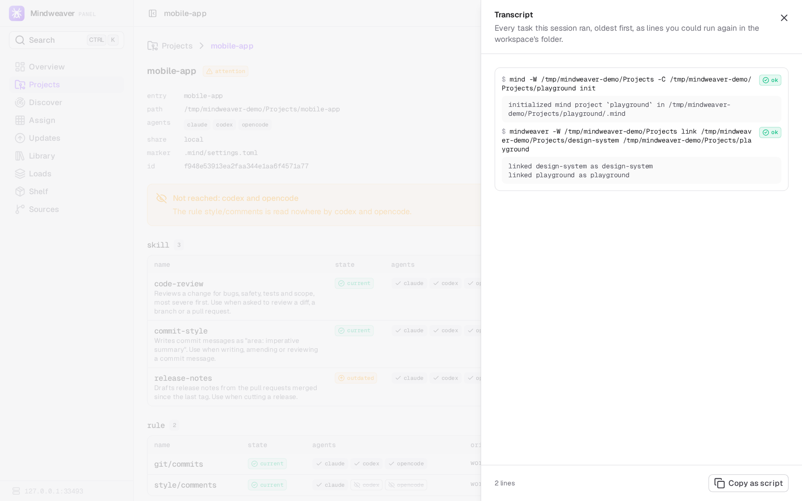

These pictures are taken by `make docs/screenshots` from a demo workspace,
so they show the panel as it is.

## An API for scripts

What the panel asks of the server is an HTTP API, there for your scripts
too: `mindweaver ui --no-open --token-file <file>` serves it without a
browser, and writes where it is and its token to the file. [The API's
guide](docs/api.md) walks through it with curl.

## From the terminal

Everything the panel does is a command, and so is everything it does not do
yet, such as gathering:

```bash
cd ~/Projects/blog && mind init              # make a repository a project
cd ~/Projects && mindweaver link blog        # and link it to the workspace
mindweaver gather git acme/skills --dry-run  # see what a repository would give
mindweaver gather git acme/skills            # put a repository's skills on the shelf
mindweaver gather update --all               # gather every source again, saying what moved
mindweaver install -p blog commit-style      # install one into a project
mindweaver status                            # what every project holds, and how it stands
mindweaver update --all --yes                # bring every project up to date
mindweaver                                   # the TUI: all of it from the keyboard
```

A gather finds a repository's skills wherever the tools that install them
keep them (`skills/<name>`, `.claude/skills/<name>`, `.agents/skills/<name>`,
`plugins/<plugin>/skills/<name>`, a `SKILL.md` at its root), and `--path`
keeps it to one folder; `acme/skills@v2` takes a branch, and a GitHub or
GitLab tree URL a branch and a folder. Two skills of one name in one
repository are a warning each, and neither is taken. `--dry-run` says what
would be taken and takes nothing.

A repository gathered is one source however its URL is spelled (`acme/skills`,
`https://github.com/acme/skills`, `git@github.com:acme/skills.git`), called
by a name, `acme-skills` unless `--name` gives it another: what `mindweaver
gather list` shows, and what `--from` takes when two sources offer one skill
([#7](https://github.com/otsobide/mindweaver/issues/7)). `--pin <commit>`
takes one commit, by its full id, rather than whatever the branch is at, and
the source keeps it beside its branch until a gather at another pin, or
none, moves it. Each gathered skill is recorded with its folder in the
repository, the commit, the hash of what was put on the shelf and its
licence as it says it, and `gather list` shows the licence, `unknown` when
nothing says one, and the commit a source is pinned to on each skill taken
at it. `gather sources` lists the sources by name, with when each was last
gathered; `gather rename` calls one another name; `gather update` gathers
some again, or every one, and takes off the shelf what a source no longer
holds, so `status` says a copy of it `orphaned`; and `gather remove` removes
one, its clone and what it put on the shelf, saying first, without `--yes`,
what it would leave orphaned.

To try it with nothing gathered, this repository's `examples/` is a
workspace of two skills and two rules: `mindweaver load <your clone>/examples`
offers them to yours.

[The reference](docs/reference.md) has every command with what it prints,
the formats Mindweaver reads and writes, `--json`, the TUI, and upgrading
from an older Mindweaver.

## MCP servers

The library keeps the MCP servers your projects use beside its skills and
rules, a definition each, written by one command from how an agent starts
the server:

```bash
mindweaver add mcp github "GitHub's issues, pull requests and code" \
  --command npx --arg -y --arg @modelcontextprotocol/server-github \
  --secret-env GITHUB_PERSONAL_ACCESS_TOKEN
```

or from where it reaches one, with `--url`. Give a secret as the name of
the environment variable an agent reads it from (`--secret-env`,
`--secret-header` or `--bearer-env`), never as its value: `--env` and
`--header` write what they are given as it is, and refuse only a value that
looks like a token. `mindweaver show mcp:github` says how each agent will be
given it. Installing it gives it to each agent the project names, an entry in
that agent's own config file, and says what each will run, then what to set
before one starts it, and that Codex reads it only once you trust the
project:

```
$ mindweaver install -p collapse github
installed mcp github into collapse, from workspace
  claude runs: npx -y @modelcontextprotocol/server-github
  codex runs: npx -y @modelcontextprotocol/server-github
  opencode runs: npx -y @modelcontextprotocol/server-github
  set GITHUB_PERSONAL_ACCESS_TOKEN (a secret) where the agents run: each reads it there, and no file holds it
  claude asks to approve it before it starts it in a session, though a run with `-p` starts it unasked
  opencode starts it without asking
warning: Codex reads `github` from /home/you/Projects/collapse/.codex/config.toml only in a project it trusts, and /home/you/.codex/config.toml does not mark /home/you/Projects/collapse `trusted`
```

A server from a workspace yours loads, or from the shelf, is a command
somebody else wrote: without `--yes`, installing it says what each agent
would run and writes nothing. The panel's [MCP page](#the-mcp-page) adds
and changes servers from a form, and Assign asks for that yes once it has
shown you the lines. [What an MCP server
looks like](docs/reference.md#what-an-mcp-server-looks-like) has every
option, and the rest.

## When an agent says nothing

Some things keep an agent from what a project gives it without a word from
the agent: a Codex project you never trusted, an `AGENTS.override.md` hiding
`AGENTS.md`, a `CLAUDE.local.md` that stops Claude reading it, a skill of the
same name in `~/.claude/skills` or `~/.agents/skills` holding something
else, an MCP server whose variable is not set. `mindweaver doctor` looks for
them in every project, or `mind doctor` in the one you are in, and names the
file each is about and what fixes it. It reads files and changes nothing,
and exits non-zero when it finds something, so it fits in CI;
[the reference](docs/reference.md#what-no-agent-says) lists every check.

## Learn more

- [The reference](docs/reference.md): every command, with what it prints.
- [Developing Mindweaver](docs/development.md): building it, testing it, and
  working on the panel.
- [Architecture](docs/architecture.md): why each part is the way it is, and
  the decisions behind it.
- [Agents](docs/agents.md): where each agent reads skills and rules, as
  checked on each one.

## Roadmap

What comes next is planned as
[milestones](https://github.com/otsobide/mindweaver/milestones), each ending
with something usable on real repositories, and each issue in them is one pull
request. [#15](https://github.com/otsobide/mindweaver/issues/15) tracks the
whole plan, and the decisions it rests on are recorded in
[docs/architecture.md](docs/architecture.md#decisions).

## License

GPL-3.0-only. See [LICENSE](LICENSE).
